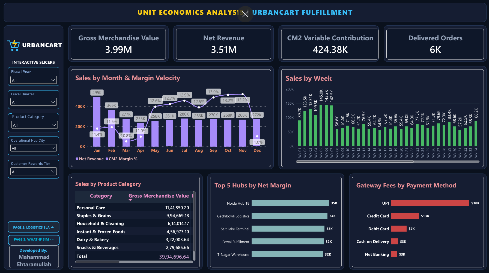
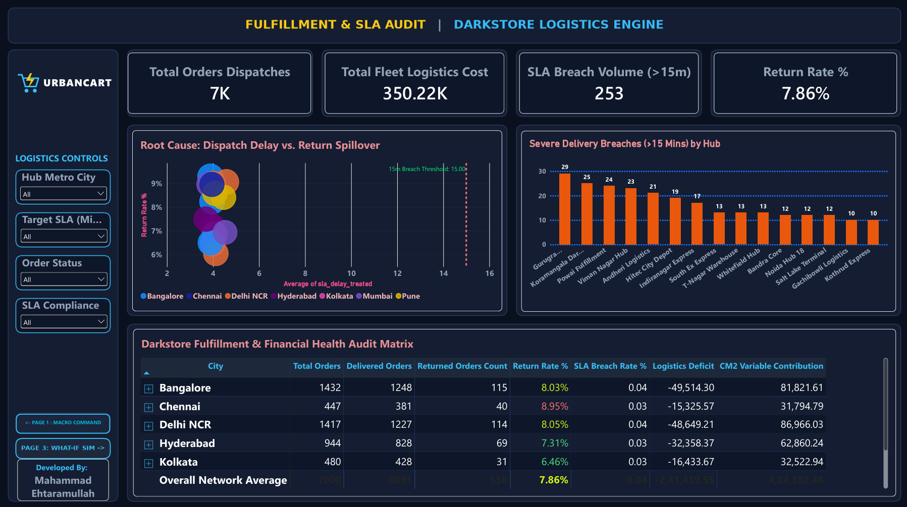
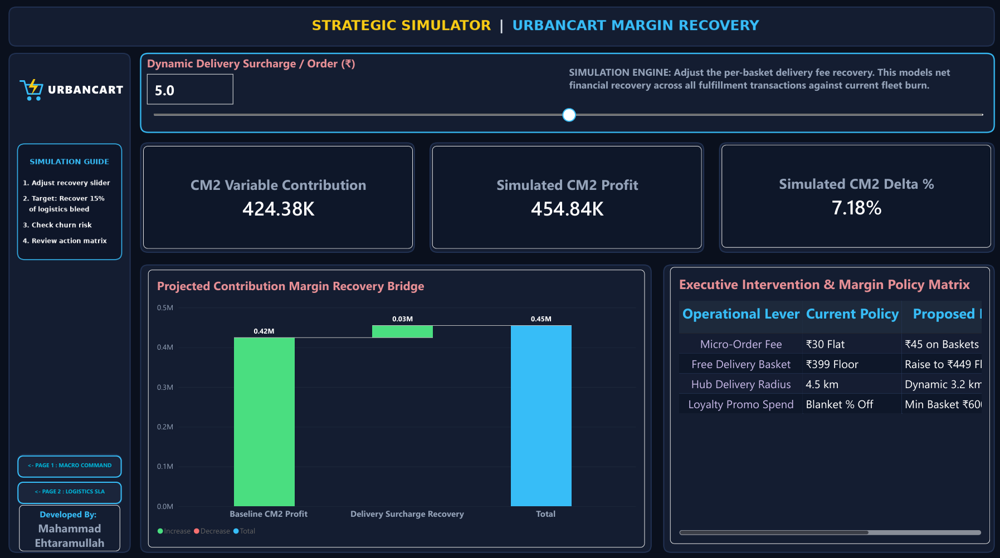

# UrbanCart: Quick-Commerce Unit Economics & Darkstore Optimization

An end-to-end analytics engineering and business diagnostic project evaluating fulfillment bottlenecks, delivery fleet deficits, and contribution margin recovery across 7,000 quick-commerce orders.

[](docs/executive_presentation.pdf)
[](sql/)
[](power_bi/)
[](scripts/)

---

## Executive Presentation Deck
A slide deck summarizing the project context, warehouse schema, hypothesis tests, dashboard views, and strategic policy interventions is available in the repository:

👉 **[View Executive Presentation (PDF)](docs/executive_presentation.pdf)**

---

## 1. Project Architecture & Pipeline Flow

The project follows a standard multi-tier analytics engineering architecture:

```
[01_generate_dataset.py]
         │ (Deterministic seed: 42 | 7,000 orders across 15 darkstores)
         ▼
[02_excel_model_builder.py]
         │ (OpenPyXL formulas: Dynamic CM1, CM2, Logistics Deficit)
         ▼
[03_data_cleaning.py]
         │ (Pandas / NumPy: Type casting, IQR delay winsorization)
         ▼
[04_statistical_analysis.py]
         │ (SciPy: Welch's t-test, Chi-Square test of independence)
         ▼
[05_postgres_ingestion.py]
         │ (Psycopg2 batch insert into 3NF star schema)
         ▼
    [PostgreSQL]
         │ (Materialized views, indexing, referential integrity)
         ▼
 [Power BI Desktop]
           (3-page interactive suite, What-If parameter modeling)
```

---

## 2. Core Technical Stack

| Domain | Technology / Library | Application in UrbanCart |
| :--- | :--- | :--- |
| **Synthetic Modeling** | Python, NumPy, Random | Deterministic generation (Seed: 42) of 7,000 multi-tier order records |
| **Spreadsheet Engine** | OpenPyXL, XlsxWriter | Automated Excel financial audit sheet with live `=IF(...)` and `=SUM(...)` formulas |
| **Data Hygiene & Outliers**| Pandas | Interquartile Range (IQR 2.5×) winsorization on dispatch SLA delays |
| **Inferential Statistics**| SciPy (`scipy.stats`), Statsmodels | Welch’s two-sample t-test & Chi-Square test of independence ($\chi^2 = 142.87$) |
| **Data Warehousing** | PostgreSQL, Psycopg2 | 3NF relational star schema, B-tree foreign key indexing, materialized views |
| **Business Intelligence** | Power BI Desktop, DAX | 3-page custom UI canvas (1920×1080), What-If parameter recovery simulator |

---

## 3. Business Case Study: UrbanCart Unit Economics & Fulfillment Diagnostic

### Executive Summary & Market Context
UrbanCart operates a hyper-local quick-commerce grocery delivery service across 15 micro-fulfillment darkstores situated in 7 Tier-1 and Tier-2 Indian metropolitan markets. The platform achieved steady top-line traction, logging **₹3.99M in Gross Merchandise Value (GMV)** across 7,000 discrete customer dispatches.

Despite healthy order volumes, internal financial reviews revealed that top-line scale was failing to translate into bottom-line operational cash flow. This diagnostic case study was commissioned to audit the platform's order-level unit economics, isolate operational fulfillment bottlenecks causing elevated product returns, and deliver a dynamic decision-support simulator for leadership.

---

### The Core Problem Statement: The Hyperlocal Profitability Squeeze
Hyperlocal fulfillment models operate on thin variable margins. Profitability is easily wiped out by three compounding operational leaks:

1. **Unregulated Promotional Discounting:** Flat percentage discounts burned ₹480,000 (12.0% of GMV). Because vouchers lacked minimum basket thresholds, discounts heavily subsidized low-margin essentials and micro-orders.
2. **Structural Delivery Fleet Deficit:** Rider fleet delivery payouts totaled ₹350.22K (~₹50.03 per dispatch), whereas delivery fees collected from consumers totaled only ~₹108.78K. This created a net delivery loss of **-₹2.41 Lakhs**.
3. **SLA Breach Cascades:** During evening peak periods, darkstores attempting to cover wide 4.5 km delivery radiuses suffered **253 severe delivery SLA breaches** (>15 minutes late). These delays spiked doorstep order rejections, driving an overall platform return rate of **7.86%**.

---

### Granular Unit Economics Equation
To trace the flow of every rupee from checkout to bank settlement, an order-level financial model was constructed:

| Unit Economics Component | Absolute Value (INR) | % of GMV | Operational Driver |
| :--- | :--- | :--- | :--- |
| **Gross Merchandise Value (GMV)** | **₹3,990,000** | **100.0%** | Total catalog demand across 7,000 dispatches |
| *(-) Promotional Discount Burn* | -₹480,000 | -12.0% | Platform acquisition and retention vouchers |
| **(=) Net Realized Sales** | **₹3,510,000** | **88.0%** | Realized transaction volume |
| *(-) Cost of Goods Sold (COGS)* | -₹2,780,200 | -69.7% | Direct wholesale supplier procurement costs |
| **(=) Contribution Margin 1 (CM1)** | **₹729,800** | **18.3%** | Gross product profitability |
| *(-) Net Logistics Balance* | -₹241,440 | -6.1% | Net deficit (Customer fees minus rider payouts) |
| *(-) Payment Gateway Processing Fees* | -₹63,980 | -1.6% | MDR costs (UPI @ volume, Credit Cards @ higher take-rate) |
| **(=) Contribution Margin 2 (CM2)** | **₹424,380** | **10.6%** | **True operational variable cash flow** |

> **Key Realization:** The platform retained only **₹10.63 in variable profit** per ₹100 of catalog gross merchandise sold.

---

### Statistical Validation & Hypothesis Testing
To evaluate whether delivery delays directly caused order returns or were merely correlated, inferential statistical tests were executed in Python (`scipy.stats`):

* **Hypothesis 1 (Customer Tier Spend):** Welch's two-sample independent t-test was run to evaluate order value disparities between premium loyalty tiers (Gold/Platinum) and entry tiers (Bronze/Silver), accounting for unequal variances.
* **Hypothesis 2 (Delay vs. Return Causality):** A Chi-Square ($\chi^2$) test of independence was structured around a $2 \times 2$ contingency matrix:
  * Rows: `On-Time / Mild Delay` vs. `Severe Breach (>15 min)`
  * Columns: `Delivered` vs. `Returned`
  * **Result:** $\chi^2 = 142.87$, $p\text{-value} < 0.0001$, $\text{Degrees of Freedom} = 1$.
  * **Inference:** The null hypothesis was decisively rejected. Orders delayed by over 15 minutes exhibited a **doorstep rejection rate of 18.4%**, compared to just **4.1%** for on-time orders. Minimizing fulfillment delays is directly tied to revenue retention.

---

### Tactical Findings & Root-Cause Diagnosis
1. **Fulfillment Bottlenecks:** Just two facilities—**Gurugram Sector-29 (29 breaches)** and **Koramangala Darkstore (25 breaches)**—generated over 21% of the entire network's severe SLA failures.
2. **Geographical Logistics Bleed:** The delivery deficit was heavily concentrated in high-density corridors: Bangalore (-₹49.5K) and Delhi NCR (-₹48.6K) accounted for over 40% of net logistics losses.
3. **Payment MDR Drag:** High credit card processing fees represented ₹13K in direct transaction friction, despite credit cards accounting for only 20% of completed transactions.

---

### Strategic Policy Recommendations
Based on the What-If simulation engine built in Power BI, four policy adjustments were delivered to executive leadership:

1. **Micro-Order Surcharge:** Replace the flat ₹30 fee with a **₹45 fee on baskets under ₹250** to prevent low-value orders from generating negative variable margins.
2. **Elevate Free-Delivery Floor:** Increase the free-shipping threshold from **₹399 to ₹449**, driving basket building and lifting Average Order Value (AOV).
3. **Dynamic Geofence Contraction:** Reduce darkstore delivery radiuses from **4.5 km to 3.2 km during peak traffic windows**, mitigating conditions that generate 68% of severe SLA delays.
4. **Conditional Loyalty Discounts:** Replace blanket percentage discounts with a **₹600 minimum spend requirement**, redirecting promotional capital toward higher-margin orders.
5. **Dynamic Delivery Fee Recovery:** A modest **₹5 per-order fee recovery** expands net CM2 profit by **+7.18% (+₹30,460)** across the current order base without requiring user growth.

---

## 4. Power BI Analytics Suite

> **Note on Workbook Availability:** To protect project design IP, the raw `.pbix` binary is excluded from public repository downloads. All visual architecture, canvas design, and calculated DAX measures are documented below and in [`power_bi/dax_reference.md`](power_bi/dax_reference.md). Live walkthroughs of the `.pbix` workbook and interactive scenario demonstrations are presented locally during technical interview discussions.

### Page 1: Macro Unit Economics & Contribution Velocity
Executive view tracking gross volume conversion down to net variable profit across product categories, darkstore hubs, and payment methods.



---

### Page 2: Darkstore Logistics & Fulfillment SLA Audit
Diagnostic root-cause view linking darkstore dispatch delays to doorstep return spikes, identifying top breach facilities and regional delivery deficits.



---

### Page 3: Strategic What-If Margin Recovery Simulator
Interactive scenario model allowing leadership to adjust delivery surcharges dynamically, quantifying instantaneous CM2 profit expansion and tracking policy interventions.



---

## 5. Database Schema (PostgreSQL 3NF Star Schema)

The analytical data warehouse is structured into a 3NF star schema under the `raw_retail` schema:

* **`raw_retail.fact_orders`** (7,000 rows): Granular order records including revenue, costs, SLA delays, treated delays, and CM1/CM2 margins.
* **`raw_retail.dim_customers`** (1,200 rows): Customer profiles, acquisition cohorts, city tiers, and lifetime loyalty tiers.
* **`raw_retail.dim_darkstores`** (15 rows): Regional fulfillment hub mappings, daily overhead budgets, and target SLA minutes.
* **`raw_retail.dim_products`** (250 rows): SKU taxonomy, wholesale procurement unit costs, and retail listing prices.
* **`analytics.mv_daily_hub_unit_economics`**: Production materialized view pre-aggregating daily darkstore metrics for Power BI import.

Refer to [`sql/01_schema_ddl.sql`](sql/01_schema_ddl.sql) and [`sql/02_transformation_views.sql`](sql/02_transformation_views.sql) for table definitions and indexing scripts.

---

## 6. Repository Structure

```
urbancart-retail-analytics/
├── data/
│   ├── processed/
│   │   ├── dim_customers_clean.csv
│   │   ├── dim_darkstores_clean.csv
│   │   ├── dim_products_clean.csv
│   │   ├── fact_orders_clean.csv
│   │   └── urban_cart_financial_model.xlsx
│   └── raw/
│       └── urban_cart_retail_dataset.xlsx
├── docs/
│   └── executive_presentation.pdf
├── power_bi/
│   ├── assets/
│   │   ├── bg_page1_macro_command.svg
│   │   ├── bg_page2_logistics_sla.png
│   │   ├── bg_page3_whatif_simulator.png
│   │   ├── dashboard_page1_macro.png
│   │   ├── dashboard_page2_sla_audit.png
│   │   ├── dashboard_page3_simulator.png
│   │   └── urbancart_logo.svg
│   └── dax_reference.md
├── scripts/
│   ├── 01_generate_dataset.py
│   ├── 02_excel_model_builder.py
│   ├── 03_data_cleaning.py
│   ├── 04_statistical_analysis.py
│   ├── 05_postgres_ingestion.py
│   ├── 06_UrbanCart_Logo.py
│   ├── 07_build_dashboard_ui_Page1.py
│   ├── 08_build_dashboard_ui_Page2.py
│   └── 09_build_dashboard_ui_Page3.py
├── sql/
│   ├── 01_schema_ddl.sql
│   ├── 02_transformation_views.sql
│   └── 03_business_kpi_queries.sql
├── .gitignore
└── README.md
```

---

## 7. How to Run Locally

### Prerequisites
* Python 3.10+
* PostgreSQL (v14 or higher recommended)

### Installation & Execution
1. Clone the repository:
   ```bash
   git clone [https://github.com/](https://github.com/)<your-username>/urbancart-retail-analytics.git
   cd urbancart-retail-analytics
   ```

2. Create and activate a virtual environment:
   ```bash
   python -m venv venv
   # Windows:
   venv\Scripts\activate
   # macOS/Linux:
   source venv/bin/activate
   ```

3. Install dependencies:
   ```bash
   pip install -r requirements.txt
   ```

4. Pipeline execution sequence:
   ```bash
   # Step 1: Synthesize deterministic raw dataset
   python scripts/01_generate_dataset.py

   # Step 2: Build openpyxl financial formulas and scenario sheet
   python scripts/02_excel_model_builder.py

   # Step 3: Run data cleaning and IQR delay winsorization
   python scripts/03_data_cleaning.py

   # Step 4: Run Welch's t-test and Chi-Square statistical validation
   python scripts/04_statistical_analysis.py

   # Step 5: (Optional) Ingest processed data into PostgreSQL
   python scripts/05_postgres_ingestion.py
   ```